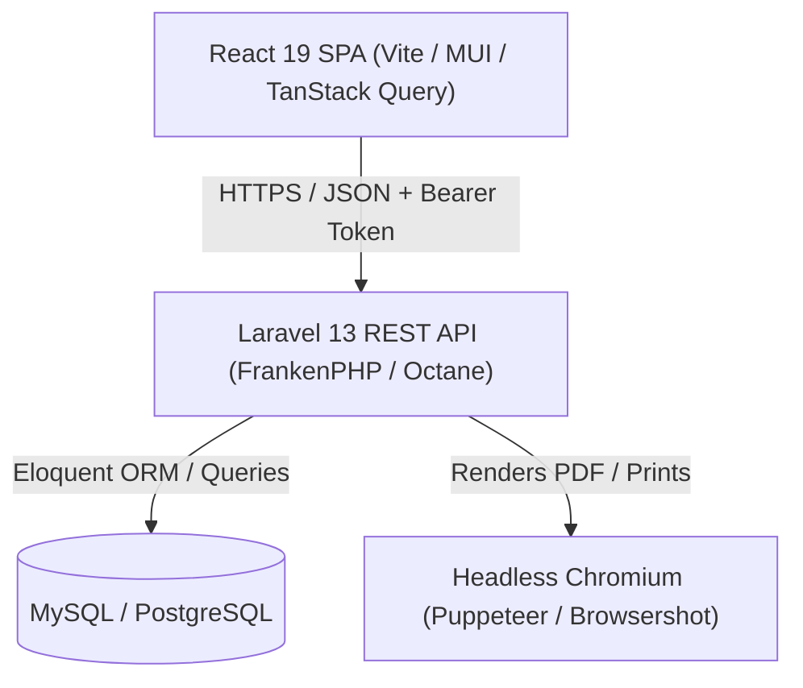
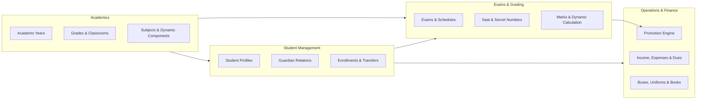

# System Architecture

This document describes the architectural design, system boundaries, and core domain subsystems of the School Management System.

This guide is for backend engineers, system architects, and full-stack developers maintaining or extending the platform. It explains how components interact across the frontend client, backend application server, database, and document generation engine.

---

## Architecture Overview

The application follows a decoupled client-server architecture with on-demand report and document generation:

### Request and Data Flow

1. **Client Interaction:** The browser loads the React single-page application (SPA). Requests to the REST API include an HTTP Bearer token or authenticated session cookie managed by Laravel Sanctum.
2. **API Layer:** Laravel Octane with FrankenPHP serves incoming requests in high-performance worker loops. Form Requests validate input data before execution passes to domain Controllers and Services.
3. **Data Access:** Eloquent ORM manages queries against the relational database, enforcing model relationships, transactions, and observers.
4. **Document and Report Generation:** PDF generation, letters, and student report cards render on demand using Spatie Browsershot driving headless Chromium, streaming output directly back to the client or storage.

---

## Core Domain Subsystems

The application organizes domain logic into modular service boundaries:

### 1. Academics and Curriculum

- **Academic Years (`academic_years`):** Maintains temporal school sessions. Exactly one academic year is active at any given moment. Changing active years scopes operations like enrollments and grade reporting.
- **Grades and Classrooms (`grades`, `classrooms`, `floors`, `buildings`):** Models educational levels (such as Grade 1 through Grade 11) and physical classrooms assigned to buildings and floors.
- **Dynamic Grading Components (`grade_subject`):** Subjects assigned to grades store assessment schemas as JSON in the `components` column (for example, Coursework vs. Final Exam allocations). This allows arbitrary grading splits per grade subject without schema migrations.

### 2. Student Records and Enrollment

- **Student Lifecycle (`students`, `guardians`, `guardian_student`):** Stores demographic information, national identifiers, emergency contacts, and guardian linkages.
- **Classroom Allocation:** Tracks student placements in specific classrooms per academic year.
- **Transfers (`student_transfers`):** Records incoming and outgoing transfers to external schools, maintaining formal auditing histories.

### 3. Examination and Assessment Engine

- **Exam Definition (`exams`):** Associates an examination instance with an academic year, grade, subject, and designated dynamic grading component (`component_id`).
- **Anonymization and Hall Logistics:**
  - **Seat Numbers (`seat_numbers`, `student_seat_assignments`):** Manages examination desk allocations and hall seating arrangements.
  - **Secret Numbers (`secret_numbers`, `student_secret_assignments`):** Generates blinded numerical identifiers for student exam papers to enable objective, double-blind grading.
- **Mark Entry (`marks`):** Stores marks per student, exam, dynamic component, and round (first round or second round / supplementary exam). Prevents marks from exceeding configured maximums.

### 4. Student Promotion Engine

- **Promotion Batches (`promotion_batches`, `promotion_batch_students`):** Evaluates student performance across all subjects at year end.
- **Eligibility Decisions:** Classifies students into:
  - `promoted`: Passed all subjects or fell within allowable failure tolerances.
  - `second_round`: Failed subjects requiring supplementary exams.
  - `repeated`: Retains current grade.
  - `graduated`: Completed the terminal grade of the institution.
- **Rollback Capability:** Promotion operations write reversible enrollment transition logs, enabling full batch rollback if administrative criteria change.

### 5. Financial Ledger and Fees

- **Student Accounts (`payments`, `payment_values`, `extra_dues`, `exemptions`):** Manages mandatory tuition fees, extra dues (such as field trips or special materials), and fee exemptions.
- **Institutional Ledger (`incomes`, `expenses`, `income_types`, `expense_types`, `bank_accounts`):** Tracks general revenue and operational expenditures across categorized general ledger accounts.

---

## Security and Access Control

### Authentication

The platform uses Laravel Sanctum for API token authentication:
- Tokens are issued upon successful authentication against the `/api/login` endpoint.
- Clients send the token in the `Authorization: Bearer TOKEN` header for subsequent requests.
- Requests without valid tokens return HTTP status `401 Unauthorized`.

### Role-Based Access Control (RBAC)

Authorization is enforced via Spatie Laravel Permission:
- Users possess roles (such as `Super Admin`, `Academic Registrar`, `Finance Officer`, `Teacher`).
- Routes are guarded using the `authorization` middleware:
  - Example: `Route::get('/reports/financial/summary', ...)->middleware('authorization:view financial-reports');`
- Unauthorized requests return HTTP status `403 Forbidden`.

### Emergency Killswitch

The application includes an emergency access control mechanism:
- Route: `/api/_ks/{uuid}`
- Allows authorized administrators to toggle platform operational state in incident scenarios.

---

## Document Generation and Auditing

### Headless Rendering (Browsershot & Puppeteer)

Official certificates, student report cards, and financial receipts require pixel-accurate output.
- Server-side Blade templates compile HTML, CSS, and dynamic variables.
- Spatie Browsershot drives a local headless Chromium process via Puppeteer to render vector PDFs.
- Generated PDFs are streamed to the client or saved directly to storage.

### Activity Logging

Auditing is performed through Spatie Activitylog:
- Critical mutations on student profiles, mark changes, and financial records automatically append audit events.
- Administrative users can inspect and filter system logs via `/api/activity-logs`.
